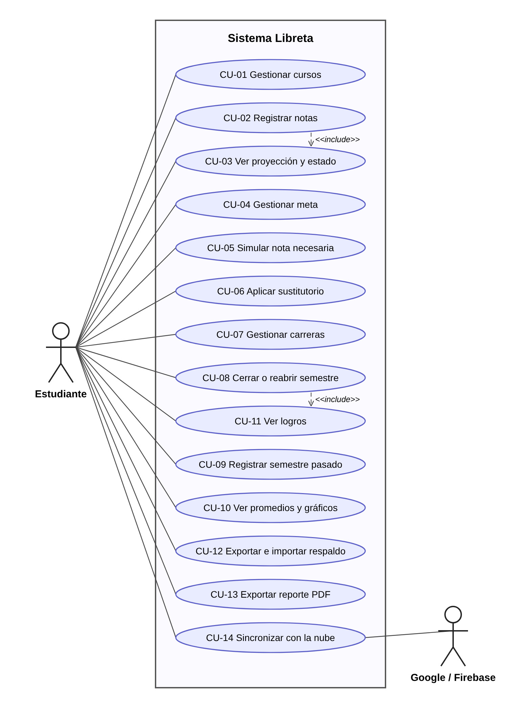
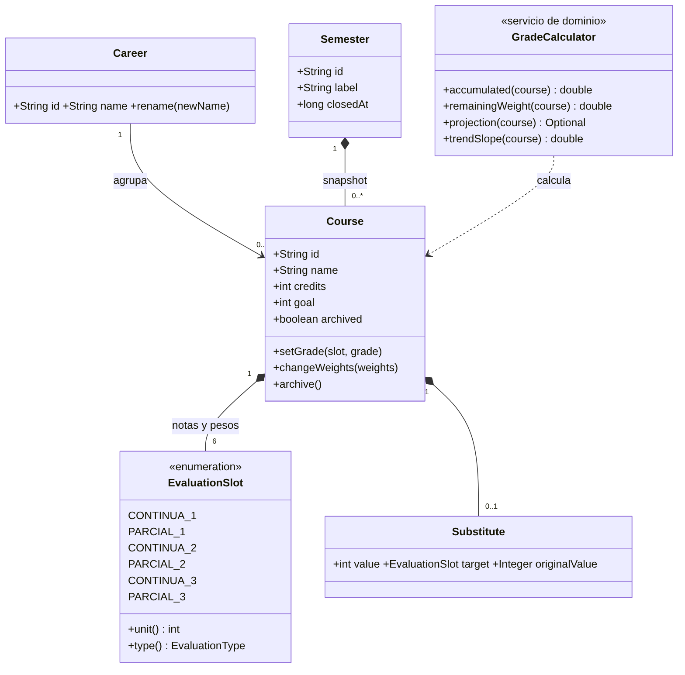
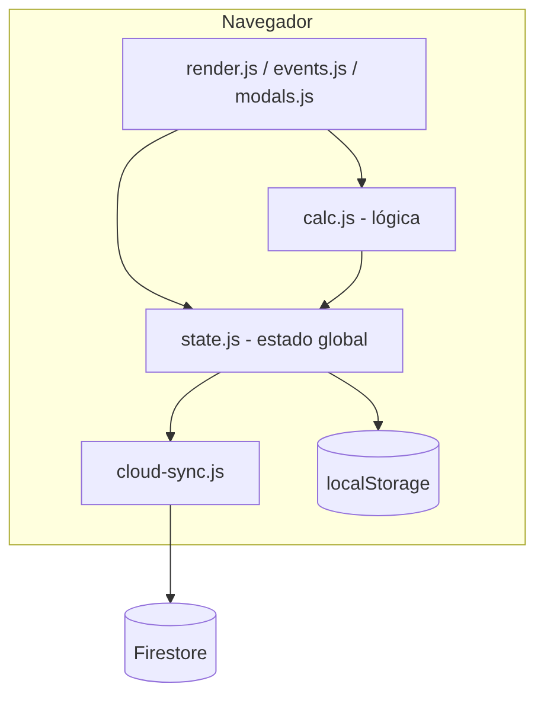
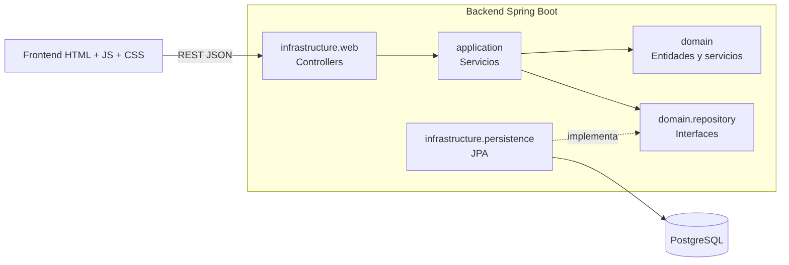
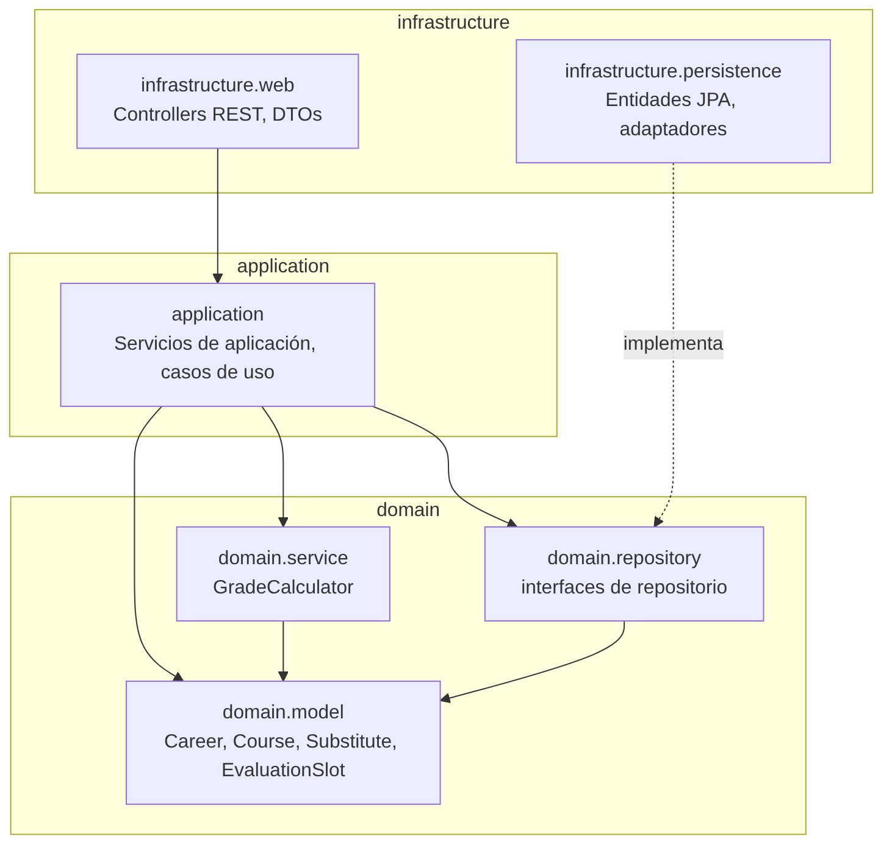
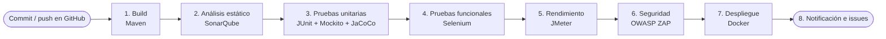
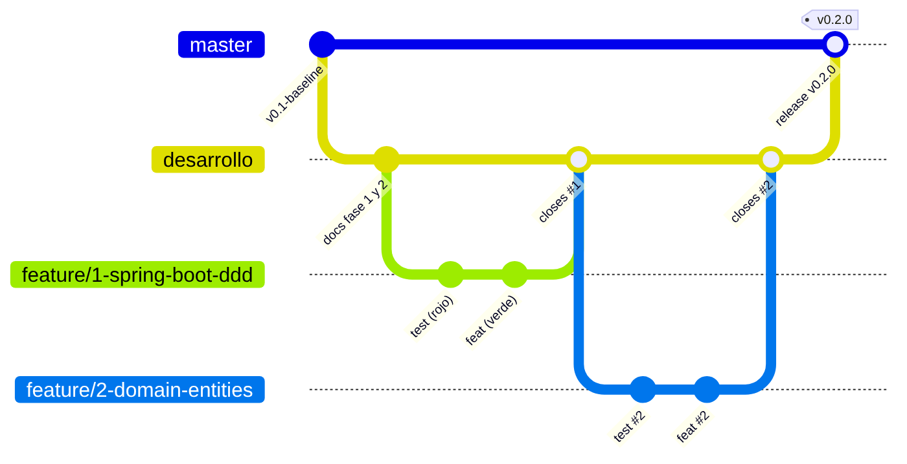

# Libreta — Calculadora de notas

**Equipo:** NodeNull · **Integrante:** Fernando Antonio Gama Llicahua (fgama@unsa.edu.pe)
**Curso:** Ingeniería de Software II · Sección A · 2026-B · Docente: Edgar Sarmiento Calisaya
**Tablero del proyecto:** GitHub Project "NodeNull Libreta" (Kanban) · **Línea base:** tag `v0.1-baseline`

## Índice
1. [Propósito](#1-propósito)
2. [Funcionalidades](#2-funcionalidades)
3. [Requisitos](#3-requisitos)
4. [Modelo de dominio](#4-modelo-de-dominio)
5. [Arquitectura](#5-arquitectura)
6. [Módulos y servicios REST](#6-módulos-y-servicios-rest)
7. [Pipeline CI/CD](#7-pipeline-cicd)
8. [Gestión del proyecto](#8-gestión-del-proyecto)
9. [Cómo ejecutar y probar](#9-cómo-ejecutar-y-probar)
10. [Estado actual](#10-estado-actual)

---

## 1. Propósito

Libreta ayuda a un estudiante universitario a registrar sus notas por evaluación, **proyectar su promedio final**,
saber si aprueba y si cumple su meta personal, **simular qué nota necesita** en lo que falta y llevar un
historial por semestres y carreras con promedio ponderado por créditos.

El proyecto parte de una aplicación web previa (v0.1, solo frontend con `localStorage`) y **evoluciona** en este
curso hacia una aplicación con backend REST (Spring Boot, DDD y Clean Architecture), pruebas automatizadas y un
pipeline CI/CD en Jenkins. La v0.1 se conserva como línea base (`v0.1-baseline`); toda la evolución está en el historial de Git.

## 2. Funcionalidades

Diagrama de casos de uso (14 casos, ver detalle en [`docs/01-ingenieria-inversa.md`](docs/01-ingenieria-inversa.md)):



Resumen: gestionar cursos y carreras, registrar notas, ver proyección y estado de aprobación, definir metas,
simular la nota necesaria, aplicar el examen sustitutorio, cerrar y reabrir semestres, ver promedios y gráficos,
logros, exportar e importar respaldos, reporte PDF y sincronización en la nube.

## 3. Requisitos

El análisis completo está en [`docs/01-ingenieria-inversa.md`](docs/01-ingenieria-inversa.md):

| Documento | Contenido |
|---|---|
| Requisitos funcionales | 24 RF, cada uno enlazado al archivo de código de origen |
| Requisitos no funcionales | 11 RNF con su estado en la v0.1 |
| Reglas de negocio | 11 RN (pesos suman 100 %, notas 0–20, sustitutorio, cierre de semestre, etc.) |
| Políticas de trabajo | [`docs/02-politicas.md`](docs/02-politicas.md): ramas, commits, pruebas, definición de terminado |

## 4. Modelo de dominio

Agregados `Course` y `Semester`, entidad `Career`, objeto de valor `Substitute`, enumeración `EvaluationSlot`
(C1, P1, C2, P2, C3, P3) y el servicio de dominio `GradeCalculator`.



## 5. Arquitectura

**Arquitectura actual (v0.1):** aplicación de una sola página; lógica, estado e interfaz en el navegador.



**Arquitectura objetivo:** frontend que consume una API REST; backend en capas DDD / Clean Architecture
(MVC + módulos + capas). El dominio no depende de Spring ni de JPA: lo verifica una prueba automática
(`LayerDependencyTest`).



**Diagrama de paquetes** (`com.nodenull.libreta`):



**Tecnologías:** HTML + CSS + JavaScript (Chart.js, jsPDF) · Java 21 · Spring Boot 3.3 · JPA/Hibernate ·
H2 (desarrollo) y PostgreSQL (producción) · JUnit 5 · Mockito · JaCoCo · Vitest · Docker · Jenkins · SonarQube ·
Selenium · JMeter · OWASP ZAP.

## 6. Módulos y servicios REST

> **Pendiente** (issues #9, #10 y #11). Se documentará con OpenAPI y Swagger UI: por módulo, nombre y propósito,
> operaciones disponibles (método, URL y parámetros) y modelos clave.

| Módulo | Propósito | Estado |
|---|---|---|
| Cursos y notas | CRUD de cursos, registro de notas, proyección y estado | Dominio listo; API pendiente |
| Semestres | Cierre, reapertura y semestres pasados | Pendiente |
| Carreras | Gestión de carreras y promedios ponderados | Pendiente |

## 7. Pipeline CI/CD

Pipeline en Jenkins disparado por cada commit al repositorio (issues #18 a #24).



| Etapa | Herramienta | Estado |
|---|---|---|
| Construcción automática | Maven | Configurado localmente |
| Análisis estático | SonarQube | Pendiente |
| Pruebas unitarias | JUnit 5 + Mockito + JaCoCo | Hecho (134 pruebas, 97 % de cobertura) |
| Pruebas funcionales | Selenium + JUnit 5 | Hecho local (32 pruebas); falta integrarlo al pipeline |
| Pruebas de rendimiento | JMeter | Pendiente |
| Pruebas de seguridad | OWASP ZAP | Pendiente |
| Gestión de issues | GitHub Issues + Project | Activo |
| Despliegue | Docker | Pendiente |

## 8. Gestión del proyecto

- **Ramas (Gitflow):** `master` ← `desarrollo` ← `feature/<n>-<nombre>`, con merge `--no-ff` por cada issue.



- **Tablero Kanban:** TO-DO → CURRENT ITERATION → IN PROGRESS → FIX VALIDATION → DONE.
- **Etiquetas:** `nuevo-requisito`, `mejora`, `correccion`.
- **Trazabilidad de la entrega:** GitHub Project → Issue → Commits (`Refs #n` / `Fix #n`) → GitHub Release.
- **Políticas completas:** [`docs/02-politicas.md`](docs/02-politicas.md). Backlog inicial: [`docs/gestion/issues.csv`](docs/gestion/issues.csv).

## 9. Cómo ejecutar y probar

**Backend** (Java 21 y Maven):

```bash
cd backend
mvn test                 # pruebas unitarias y de integración (134)
mvn verify               # además exige >= 80 % de cobertura en domain y application (JaCoCo)
mvn spring-boot:run      # API en http://localhost:8080
```

Reportes (Lab 05): `./scripts/generar-reportes.sh` los deja en `docs/reportes/`
(`ejecucion/surefire-report.html` y `cobertura/index.html`). Casos de prueba: [`docs/pruebas/lab05-casos-de-prueba.md`](docs/pruebas/lab05-casos-de-prueba.md).

**Pruebas funcionales** (Selenium + JUnit 5, Chrome o Firefox; Lab 06):

```bash
cd pruebas-funcionales
mvn test                              # 32 pruebas, navegador sin ventana
mvn test -Dheadless=false             # con ventana
mvn test -Dbrowser=firefox            # otro navegador
```

El reporte HTML queda en `pruebas-funcionales/target/site/surefire-report.html`. Casos de prueba:
[`docs/pruebas/lab06-casos-de-prueba.md`](docs/pruebas/lab06-casos-de-prueba.md).

**Frontend** (sin build): abrir `index.html` o servirlo con `python3 -m http.server 8000`.
Pruebas del frontend: `npm install && npm test` (Vitest). Detalles en [`docs/manual-frontend.md`](docs/manual-frontend.md).

## 10. Estado actual

Línea base: `v0.1-baseline`. Versión en desarrollo: `0.2.0-SNAPSHOT`.

| Issue | Descripción | Estado |
|---|---|---|
| #1 | Proyecto Spring Boot con estructura DDD | Hecho |
| #2 | Entidades `Career` y `Course` con invariantes | Hecho |
| #3 | Acumulado, proyección y tendencia (`GradeCalculator`) | Hecho |
| #4 | Estado de aprobación, meta, redondeo y nota final | Hecho |
| #5 | Sustitutorio en el dominio | Hecho |
| #6 | `Semester` y cierre/reapertura | Hecho |
| #7 | Repositorios JPA de `Course` y `Semester` | Hecho |
| #8 | Servicios de aplicación con Mockito | Hecho |
| #14 | JaCoCo y reportes de cobertura | Hecho |
| #19 | Pruebas funcionales con Selenium | Hecho |
| #25 | Documentación: README, diagramas y políticas | Hecho |
| #26 | Corregir validación de créditos y pesos (defectos hallados por Selenium) | Hecho |
| #9 a #13 | API REST, OpenAPI y conexión del frontend | Pendiente |
| #15 a #18 | Seguridad (Firestore, XSS, configuración) y Docker | Pendiente |
| #20 a #24 | JMeter, ZAP, Jenkins, SonarQube y notificaciones | Pendiente |

**Calidad actual**

| Indicador | Valor |
|---|---|
| Pruebas de backend (JUnit 5 + Mockito) | 134 pasan, 0 fallos |
| Cobertura JaCoCo (instrucciones / ramas) | 97 % / 87 % |
| Pruebas funcionales (Selenium) | 32 pasan, 0 fallos |
| Defectos corregidos | 3 (DEF-01, DEF-02 y DEF-03; ver `docs/pruebas/lab06-casos-de-prueba.md`) |

Se actualiza este README al cerrar cada issue.
