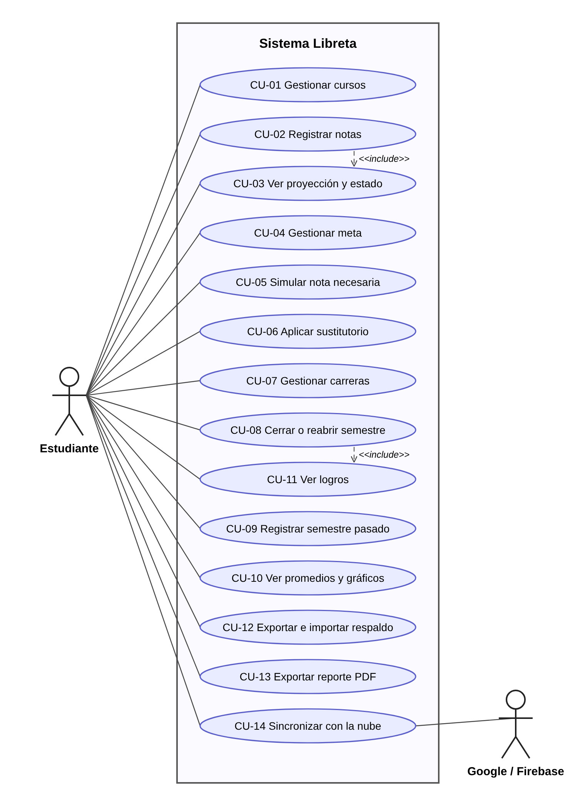
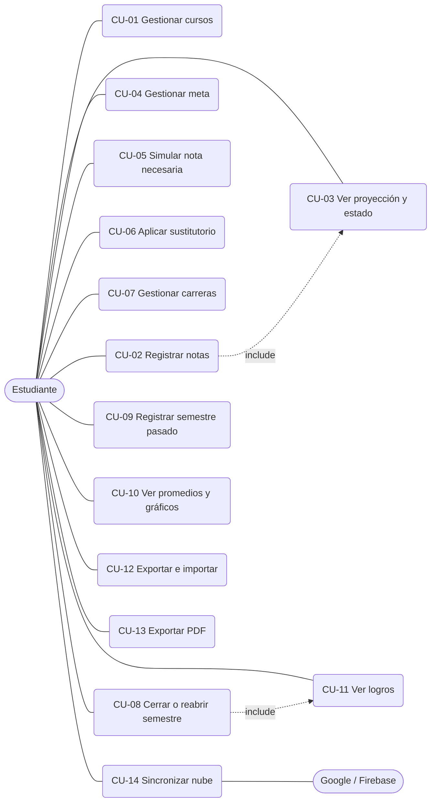
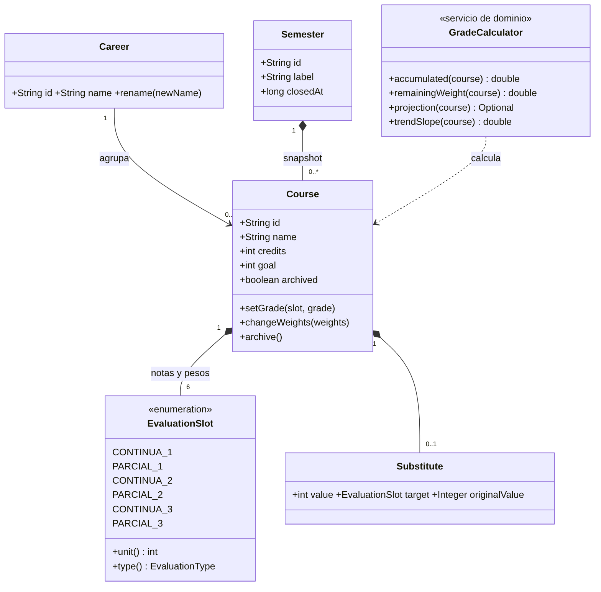
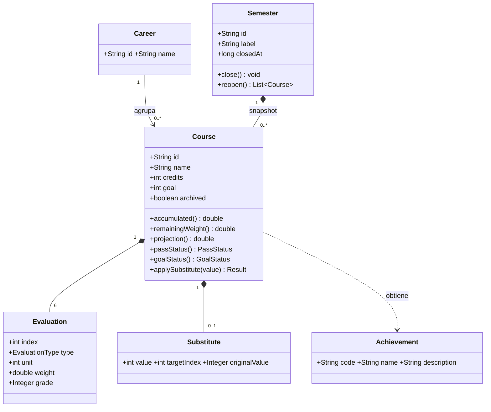
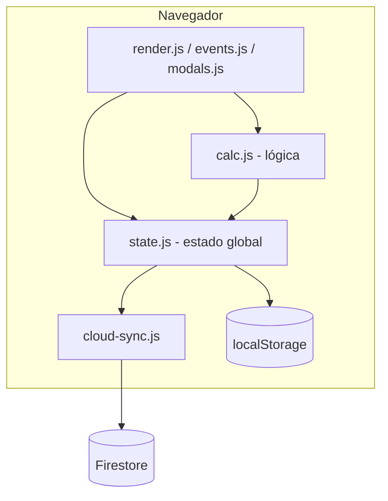
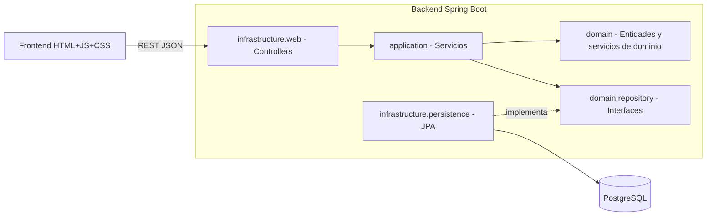

# Fase 1 — Ingeniería inversa de Libreta v0.1

**Equipo:** NodeNull · **Integrante:** Fernando Antonio Gama Llicahua
**Línea base:** tag `v0.1-baseline` (proyecto previo, anterior a la evolución del curso)

## Índice
1. Propósito
2. Alcance y contexto
3. Requisitos funcionales (RF)
4. Requisitos no funcionales (RNF)
5. Reglas de negocio (RN)
6. Casos de uso
7. Modelo de dominio
8. Arquitectura actual (as-is) y objetivo (to-be)
9. Brechas detectadas y backlog inicial
10. Guía para dibujar en StarUML

---

## 1. Propósito

Libreta permite a un estudiante universitario registrar sus notas por evaluación, proyectar su promedio final,
saber si aprueba y si cumple su meta personal, simular qué nota necesita en lo pendiente, y llevar un historial
por semestres y carreras con promedio ponderado por créditos.

## 2. Alcance y contexto

- **Actor principal:** Estudiante (único usuario, sin roles).
- **Sistemas externos:** Google (login), Firebase Firestore (sincronización), CDN (Chart.js, jsPDF, fuentes).
- **Modelo de evaluación:** 6 evaluaciones por curso: Continua 1, Parcial 1, Continua 2, Parcial 2, Continua 3, Parcial 3.
  Notas enteras de 0 a 20; nota aprobatoria 10,5.

## 3. Requisitos funcionales

| ID | Requisito | Origen en el código |
|----|-----------|---------------------|
| RF-01 | Crear un curso con nombre, carrera, créditos y pesos (%) de las 6 evaluaciones | `modals.js: openCreateModal` |
| RF-02 | Editar carrera, créditos y pesos de un curso | `modals.js: openEditCourseModal` |
| RF-03 | Eliminar un curso (con confirmación) | `events.js: delete-course` |
| RF-04 | Archivar y desarchivar un curso; mostrar u ocultar archivados | `events.js: archive, unarchive, toggle-archived` |
| RF-05 | Registrar, modificar o borrar la nota de cada evaluación (0–20, redondeada a entero) | `events.js: startEditGrade` |
| RF-06 | Calcular el acumulado ponderado de lo ingresado y el peso pendiente | `calc.js: acumulado, remainingWeight` |
| RF-07 | Proyectar la nota final por regresión lineal ponderada por unidad (U1, U2, U3), acotada a [0, 20] | `calc.js: projection, buildPredictor, linearFit` |
| RF-08 | Mostrar la tendencia (↑ → ↓) del curso | `calc.js: trendSlope, trendArrow` |
| RF-09 | Determinar el estado de aprobación (Aprobado, Desaprobado, No podrás aprobar, Muy difícil aprobar, Aprobación asegurada, En curso) | `calc.js: passStatus` |
| RF-10 | Definir una meta personal por curso (por defecto 11) y evaluar su estado (alcanzada, por redondeo, ajustada, en riesgo, sin datos) | `calc.js: metaStatus` |
| RF-11 | Simular "¿qué necesito sacar?" para una meta: nota exacta con 1 pendiente, tabla de combinaciones con 2, referencia con 3 o más | `events.js: runSimulator` |
| RF-12 | Aplicar un examen sustitutorio que reemplaza el parcial más bajo si lo supera; poder quitarlo | `calc.js: applySustitutorio` |
| RF-13 | Gestionar carreras (crear, renombrar, eliminar) | `modals.js: openCareersModal` |
| RF-14 | Cerrar el semestre actual (solo si no hay cursos con notas pendientes) guardando una copia de los cursos | `semesters-courses.js: closeSemester` |
| RF-15 | Reabrir un semestre cerrado, devolviendo sus cursos a la lista activa | `semesters-courses.js: reopenSemester` |
| RF-16 | Registrar un semestre pasado ingresando solo la nota final por curso (pesos por defecto 15/15/15/15/20/20) | `modals.js: openAddPastSemesterModal` |
| RF-17 | Calcular promedio ponderado por créditos: oficial (semestres cerrados) y estimado (incluye el semestre actual) por carrera | `calc.js: creditWeightedAvg, overallCareerStats` |
| RF-18 | Graficar la evolución real y proyectada por curso y por carrera | `render.js: makeLineChart` |
| RF-19 | Calcular y mostrar logros por curso y por semestre (9 logros) | `calc.js: calculateCourseAchievements` |
| RF-20 | Exportar e importar los datos en JSON | `import-export.js` |
| RF-21 | Exportar reporte PDF de un curso o de un semestre | `pdf-report.js` |
| RF-22 | Alternar tema oscuro y claro, recordando la preferencia | `state.js: setTheme` |
| RF-23 | Iniciar sesión con Google y sincronizar el estado en tiempo real entre dispositivos | `cloud-sync.js` |
| RF-24 | Funcionar sin conexión e instalarse como PWA | `service-worker.js, manifest.json` |

## 4. Requisitos no funcionales

| ID | Categoría | Requisito | Estado v0.1 |
|----|-----------|-----------|-------------|
| RNF-01 | Usabilidad | Interfaz en español, responsive (móvil y escritorio), con tema claro y oscuro | Cumple |
| RNF-02 | Disponibilidad | Uso sin conexión mediante service worker | Cumple |
| RNF-03 | Portabilidad | Funciona en navegadores modernos y es instalable (PWA) | Cumple |
| RNF-04 | Persistencia | Los datos sobreviven al cierre del navegador (localStorage) | Cumple, pero se pierde al borrar el navegador |
| RNF-05 | Precisión | Los cálculos corrigen errores de punto flotante antes de redondear | Cumple (`roundGrade`) |
| RNF-06 | Mantenibilidad | Módulos separados por responsabilidad | Parcial: scripts globales sin encapsulación |
| RNF-07 | Testabilidad | Lógica de cálculo cubierta por pruebas automatizadas | Parcial: 39 pruebas solo sobre `calc.js` |
| RNF-08 | Seguridad | Datos del usuario aislados por cuenta en la nube | Por verificar: reglas de Firestore |
| RNF-09 | Seguridad | Escapar el HTML del usuario antes de renderizarlo | Parcial: `esc()` existe, falta auditar todas las plantillas |
| RNF-10 | Rendimiento | Primera carga sin build y actualización inmediata de la UI | Cumple |
| RNF-11 | Privacidad | Sin backend propio: los datos no salen del navegador salvo con sincronización activada | Cumple |

## 5. Reglas de negocio

| ID | Regla |
|----|-------|
| RN-01 | Los pesos de las 6 evaluaciones deben sumar 100 % (tolerancia ±0,5) |
| RN-02 | Las notas son enteras entre 0 y 20 |
| RN-03 | Nota aprobatoria: 10,5; la nota final oficial es el promedio redondeado |
| RN-04 | La continua y el parcial de una misma unidad comparten la misma X en la regresión |
| RN-05 | Una evaluación con peso 0 % no influye en la tendencia |
| RN-06 | El sustitutorio solo se aplica si supera la nota más baja entre P1 y P2, y la reemplaza |
| RN-07 | No se puede cerrar el semestre si algún curso no archivado tiene notas pendientes |
| RN-08 | Los cursos sin créditos no entran en el promedio ponderado |
| RN-09 | Un curso archivado queda exento del cierre de semestre y de los logros |
| RN-11 | Una carrera solo se elimina si ningún curso (activo o histórico) la usa, y debe quedar al menos una |
| RN-10 | Al abrir la app sin datos se crea la carrera por defecto "Ciencia de la Computación" |

## 6. Casos de uso

**Actor:** Estudiante. **Actor secundario:** Google/Firebase.

| ID | Caso de uso | RF |
|----|-------------|----|
| CU-01 | Gestionar cursos (crear, editar, archivar, eliminar) | RF-01 a RF-04 |
| CU-02 | Registrar notas | RF-05, RF-06 |
| CU-03 | Consultar proyección y estado de aprobación | RF-07 a RF-09 |
| CU-04 | Gestionar meta personal | RF-10 |
| CU-05 | Simular nota necesaria | RF-11 |
| CU-06 | Aplicar sustitutorio | RF-12 |
| CU-07 | Gestionar carreras | RF-13 |
| CU-08 | Cerrar o reabrir semestre | RF-14, RF-15 |
| CU-09 | Registrar semestre pasado | RF-16 |
| CU-10 | Consultar promedios por carrera y gráficos | RF-17, RF-18 |
| CU-11 | Ver logros | RF-19 |
| CU-12 | Exportar e importar respaldo | RF-20 |
| CU-13 | Exportar reporte PDF | RF-21 |
| CU-14 | Sincronizar con la nube | RF-23 |

## 7. Modelo de dominio

(Fuente editable en `docs/diagramas/02-modelo-de-dominio.mmd`.)

Entidades y objetos de valor identificados en `state`:

- **Career** (entidad): `id`, `name`.
- **Course** (agregado raíz): `id`, `name`, `careerId`, `credits`, `goal`, `archived`, `createdAt`, 6 `Evaluation`, `Substitute` opcional.
- **Evaluation** (objeto de valor): `index` 0–5, `type` (continua o parcial), `unit` (1–3), `weight`, `grade` opcional.
- **Substitute** (objeto de valor): `value`, `targetIndex`, `originalValue`.
- **Semester** (agregado raíz): `id`, `label`, `closedAt`, copia de cursos (snapshot).
- **Achievement** (objeto de valor o catálogo): 9 tipos.
- **Servicios de dominio** (hoy en `calc.js`): `GradeCalculator`, `ProjectionService`, `PassStatusService`, `GoalStatusService`, `SubstituteService`, `AchievementService`, `CareerStatsService`.

## 8. Arquitectura

**As-is (v0.1):** SPA monolítica en el navegador. Scripts globales cargados en orden desde `index.html`; la
lógica de negocio (`calc.js`) convive con el estado global (`state.js`) y la UI (`render.js`, `events.js`, `modals.js`).
La persistencia es `localStorage` más un documento Firestore por usuario.

**To-be (evolución):** frontend consume una API REST; backend Spring Boot en capas DDD.

Paquetes objetivo: `com.nodenull.libreta.{domain, application, infrastructure}`.

## 9. Brechas y backlog inicial

| ID | Tipo | Descripción |
|----|------|-------------|
| G-01 | Nuevo requisito | Backend REST Spring Boot con persistencia JPA y PostgreSQL |
| G-02 | Nuevo requisito | Migrar la lógica de `calc.js` al dominio Java, usando las 39 pruebas como especificación |
| G-03 | Nuevo requisito | Documentación OpenAPI y Swagger |
| G-04 | Mejora | Separar lógica pura de UI y estado global en el frontend |
| G-05 | Mejora | Pruebas unitarias del dominio, repositorio y servicios con Mockito y JaCoCo |
| G-06 | Corrección | Revisar reglas de Firestore y la exposición de la configuración en el repo |
| G-07 | Corrección | Auditar el uso de `innerHTML` y `esc()` ante XSS |
| G-08 | Nuevo requisito | Dockerfile y docker-compose |
| G-09 | Nuevo requisito | Pipeline Jenkins: build, Sonar, pruebas, Selenium, JMeter, ZAP, Docker |
| G-10 | Mejora | Ocultar la clave de Firebase detrás de configuración de entorno |

## 10. Guía para dibujar en StarUML

1. **Casos de uso:** `Model → Add Diagram → Use Case Diagram`. Actor "Estudiante" y "Google/Firebase"; 14 casos según la sección 6; relaciones `include` según el diagrama.
2. **Modelo de dominio:** `Class Diagram`. Clases de la sección 7; composición de `Course` a `Evaluation` y `Substitute`, asociación `Career`–`Course`, `Semester`–`Course`.
3. **Paquetes:** `Package Diagram` con `domain`, `application`, `infrastructure.web`, `infrastructure.persistence`; dependencias hacia `domain`.
4. Exporta cada diagrama como PNG a `docs/img/` y enlázalos desde el README.
